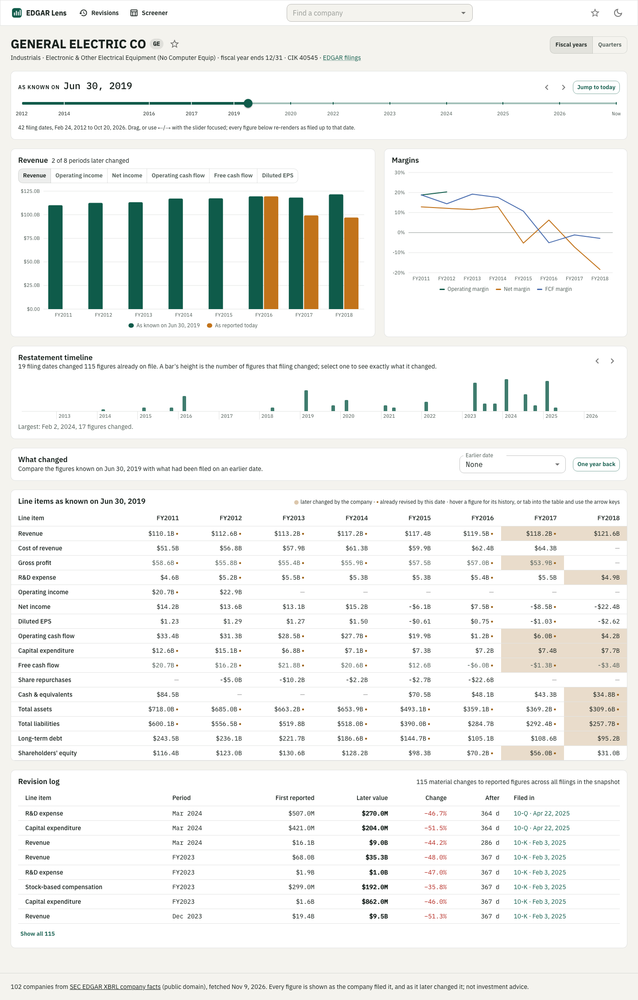
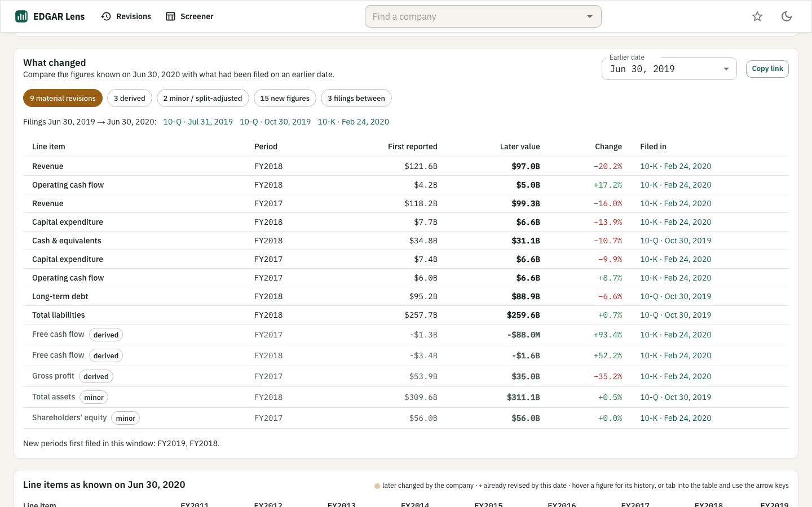
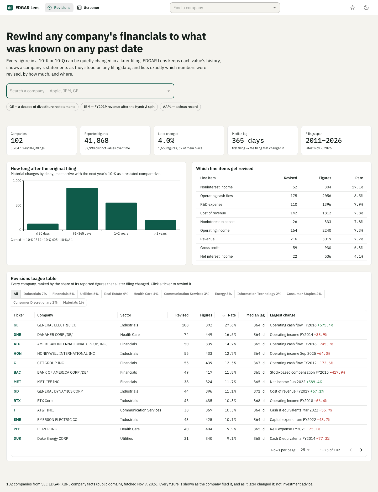
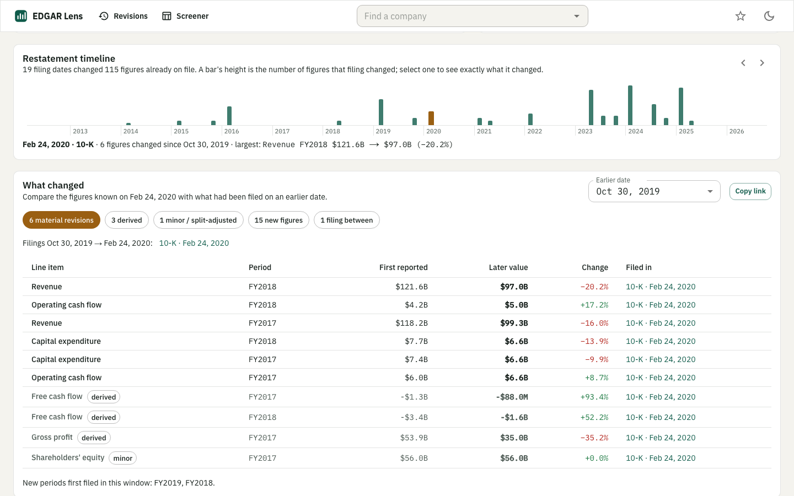
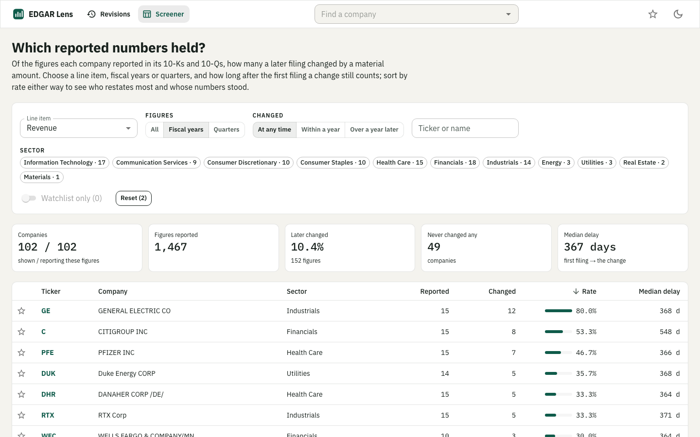
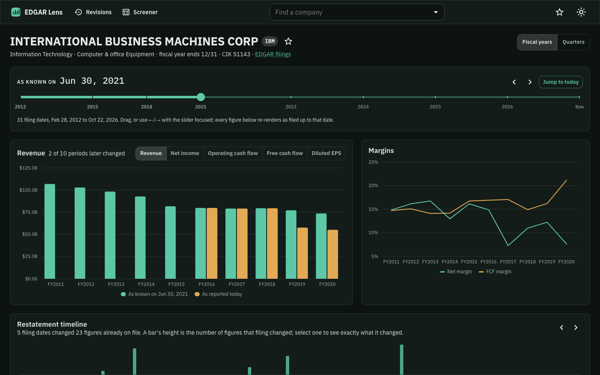
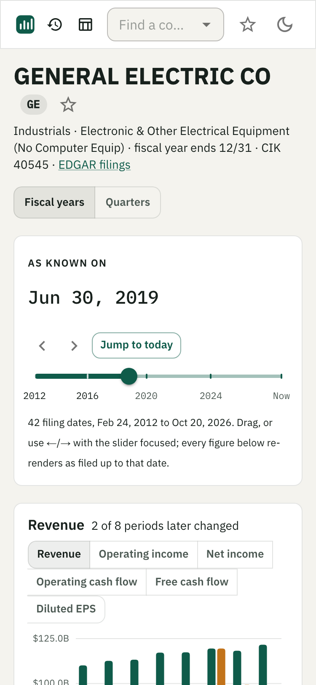

# EDGAR Lens

Rewind any US public company's financials to what was known on any past date, and see exactly which numbers were later changed.

A figure in a 10-K is not final. The next year's 10-K can carry a different value for the same period: a restatement, a reclassification after a spin-off, a discontinued operation pulled out of revenue. Most data sources show only the latest value, which means a backtest or a "what did the market know?" question quietly uses numbers nobody had at the time. EDGAR Lens keeps every value a figure has had, with the filing that carried it.



## What it does

- **Date scrubber.** One stop per filing date. Move it and every chart and table re-renders with what had been filed on or before that date. The date lives in the URL (`/company/GE?asOf=2019-06-30`), so a view can be linked.
- **What changed.** Pick two dates; every figure whose value differs between them is listed with its old value, new value and a link to the EDGAR filing that changed it (`?asOf=2020-06-30&vs=2019-06-30`).
- **Restatement timeline.** Every filing date on which a company changed figures it had already reported, on a calendar axis; a bar's height is the number of figures that filing changed. Each bar is a link: selecting it sets the as-of date to that filing and the comparison to the filing date before it, so the panel below lists exactly what that one filing changed (`/company/GE?asOf=2020-02-24&vs=2019-10-30` is GE's FY2019 10-K restating FY2018 revenue from $121.6B to $97.0B). The count on a bar is, by construction, the count in the diff it opens; a test checks that, and that the bars add up to the company's revision log.
- **Revision statistics.** The home page shows how often reported figures are later changed across all 102 companies: by line item, by sector, by the delay before the change arrives, and the ten companies that revise most.
- **Revision screener.** "Which reported numbers held?" Pick a line item, fiscal years or quarters, and how long after the first filing a change still counts; every company is ranked by the share of those figures a later filing changed, sortable either way (`/screener?item=revenue&period=annual&lag=after1y`). Each company is cut into (line item, period type) cells and every selection is a sum over cells, so the screener's totals reconcile with the home page's; a test checks that.

| What changed between two dates | Home: who revises most |
|---|---|
|  |  |

| Restatement timeline: one filing selected, and what it changed |
|---|
|  |

| Revision screener: revenue, fiscal years |
|---|
|  |

| Dark mode | Phone (375 px) |
|---|---|
|  |  |

The screenshots are captured from the production build by `npm run screenshots` (Playwright).

## How point-in-time works

SEC's company facts API returns every value ever tagged, from every filing. Apple's FY2022 revenue appears in the FY2022, FY2023 and FY2024 10-Ks. The snapshot builder groups those taggings by reporting period and keeps a **vintage** for the first filing and for each later filing whose value differs. Then:

- **As of date D** is the last vintage with `filed <= D`. Before the first filing there is no value, and the period does not appear.
- **Two filings on the same day** are ordered by accession number, so the later accession is in force from that day.
- **An unchanged comparative** (the same number repeated in next year's 10-K) is not a vintage.
- **A coarser quote of the same number** is not a vintage either. IBM's FY2019 revenue of $77,147M reappears in a 10-Q as "$77 billion". Ignoring such quotes removed 454 vintages from the snapshot (53,452 to 52,998) and 6 false revisions. A value quoted to a single significant digit is kept as a change, so this rule cannot hide a real restatement.
- **A revision counts** when the change is at least 0.5% and at least $1M ($0.01 for per-share figures). Per-share values that move by a whole-number factor are treated as stock splits.
- **Derived figures** (free cash flow, gross profit where untagged, quarters computed from year-to-date values) are recomputed at each filing date of their inputs. They are shown and labelled, and never counted as revisions, because that would count one restatement twice.

The logic is in [`src/lib/edgar/pointInTime.ts`](src/lib/edgar/pointInTime.ts) and is pure.

### Checked against the filings

Three restatements, each compared by hand with the income statement in the filing itself on sec.gov:

| Figure | First reported | Later value | Changed in |
|---|---|---|---|
| GE revenue, FY2018 | $121,615M, 10-K filed 2019-02-26 | $97,012M | [10-K filed 2020-02-24](https://www.sec.gov/Archives/edgar/data/40545/000004054520000009/0000040545-20-000009-index.htm) |
| IBM revenue, FY2019 | $77,147M, 10-K filed 2020-02-25 | $57,714M (after the Kyndryl separation) | [10-K filed 2022-02-22](https://www.sec.gov/Archives/edgar/data/51143/000155837022001584/0001558370-22-001584-index.htm) |
| Pfizer revenue, FY2019 | $51,750M, 10-K filed 2020-02-27 | $41,172M, then $40,905M | [10-K filed 2021-02-25](https://www.sec.gov/Archives/edgar/data/78003/000007800321000038/0000078003-21-000038-index.htm), [10-K filed 2022-02-24](https://www.sec.gov/Archives/edgar/data/78003/000007800322000027/0000078003-22-000027-index.htm) |

All seven values matched the filings. Three companies is a spot check, not an audit of the snapshot.

## Numbers

Everything here is measured from the committed snapshot or from a local run. Nothing is estimated.

**Snapshot** (`data/snapshot.json`, 2.2 MB, SEC data fetched 9 Nov 2026):

| | |
|---|---|
| Companies | 102 large-cap US filers across 11 sectors |
| Raw SEC facts scanned | 2,982,294 |
| Reported figures kept (line item × period) | 41,868, across 20 line items |
| Distinct values over time (vintages) | 52,998 |
| 10-K / 10-Q filings referenced | 3,204, filed Nov 2011 to Nov 2026 |
| Figures materially changed by a later filing | 1,658 (4.0%), 62 of them more than once |
| Median delay before the first change | 365 days |
| Material changes by delay | 122 within 90 days, 851 in 91–365 days, 550 in 1–2 years, 197 after 2 years |
| Carried in | 10-K 1,314, 10-Q 405, 10-K/A 1 |
| Highest revision rate | GE, 108 of 392 figures (27.6%) |
| By sector | Industrials 7.3% highest, Materials 1.1% lowest |

**GraphQL latency**, `npm run measure`: the four documents the UI sends, 1,200 sequential requests over HTTP to `next start` on localhost with random companies and dates, after a 50-request warm-up. Apple M3 (8 cores), Node 22.18.

| Document | p50 | p95 | max |
|---|---|---|---|
| Home | 3.9 ms | 12.0 ms | 56.4 ms |
| Company as of a date | 11.0 ms | 21.2 ms | 66.4 ms |
| Diff between two dates | 7.2 ms | 17.9 ms | 122.0 ms |
| Restatement timeline | 3.3 ms | 7.5 ms | 29.2 ms |
| All | 7.6 ms | 19.6 ms | 122.0 ms |

This is a single client on the same machine as the server, and the machine was busy with unrelated work during the run (load average about 15), so the figures are slower than an idle run would give. It says nothing about network latency or concurrent load.

**JavaScript downloaded on a cold first load**, `npm run measure`, from the production build (gzip as transferred, with the route chunks Next prefetches for the nav links):

| Route | First version | After the first pass | Now | Decoded now |
|---|---|---|---|---|
| `/` | 524 kB | 290 kB | 288 kB | 897 kB |
| `/screener` | 524 kB | 290 kB | 288 kB | 897 kB |
| `/company/GE` | 546 kB | 414 kB | 312 kB | 969 kB |

"First version" is commit `0d61550` and "after the first pass" is commit `3337504`, each measured with the same script on the same machine. The first pass removed the data grid (a table of about a hundred rows is a plain table with its own sort), made the home page's four-bar chart CSS, loaded the watchlist drawer when first opened, and stopped text inputs pulling in MUI's menu and modal. The second replaced the charting library (96 kB) with about 300 lines of SVG in [`src/components/charts`](src/components/charts): the company page lost 102 kB while gaining the restatement timeline. `SCRIPTS=1 npm run measure` lists every script.

**Server function size**, `npm run measure`, from the files `next build` traces for each on-demand route together with the Next server runtime, uncompressed: 45.1 MB for `/api/graphql` and 45.3 MB for `/company/[ticker]`, each including the 2.2 MB snapshot.

**Tests:** 120 unit tests (Vitest) and 24 end-to-end tests (Playwright, against the production build). Nine of the end-to-end tests run axe-core's WCAG 2 A/AA rules over the home, company and screener pages in light mode, dark mode and at 375 px, and expect no violations; three more drive the charts, the line-item table and the restatement timeline from the keyboard.

## Architecture

```
SEC EDGAR (data.sec.gov)                        build time, offline afterwards
  companyfacts + submissions JSON
        │  scripts/fetch-sec.ts        polite fetch (≤ 5 req/s), cached in .cache/sec
        ▼
  scripts/build-snapshot.ts
        │  src/lib/edgar/normalize.ts    periods, concept fallbacks, quarters from YTD
        │  src/lib/edgar/pointInTime.ts  vintages, as-of, diffs, materiality
        │  src/lib/edgar/revisionStats.ts league tables
        ▼
  data/snapshot.json                   committed; the app makes no SEC calls at runtime
        │
────────┼──────────────────────────────────────────────────────────────── runtime
        ▼
  src/server/dataset.ts                in-memory query layer, every read takes asOf
        ▼
  /api/graphql                         GraphQL Yoga route handler
        │  src/server/graphql/         schema, resolvers, depth limit 8, cost limit 25,000
        ▼
  RTK Query (src/store/api.ts)         one cache entry per (company, period, asOf)
        ▼
  Redux Toolkit slices                 rewind (asOf, vs, period), screener, watchlist
        │  two-way URL sync
        ▼
  MUI components                       scrubber, as-of table, SVG charts, restatement timeline, diff, revision screener
```

Types for both sides of the GraphQL boundary are generated from the schema (`npm run codegen`); CI fails if they are stale.

## Run it

```bash
npm ci
npm run dev            # http://localhost:3000
```

```bash
npm run typecheck
npm run lint
npm test               # unit tests
npm run build
npx playwright install chromium
npm run test:e2e       # starts the production build on :3210
```

## Deploy

It is not deployed anywhere yet. It is built to run on Vercel's free (Hobby) plan without changes: import the repository, keep the Next.js preset and the default build command, and set no environment variables. Nothing at runtime calls SEC or any other service, and there is no database. `/` and `/screener` are prerendered; `/company/[ticker]` and `/api/graphql` are Node functions that read `data/snapshot.json` (2.2 MB), which `outputFileTracingIncludes` in `next.config.ts` copies into each function. The files traced for each function come to about 45 MB uncompressed (measured above), against Vercel's limit of 250 MB per function. The snapshot is parsed once per function instance, on its first request, so the first request after a cold start is slower than the latency table suggests; that has not been measured on Vercel.

```bash
npx vercel            # a preview deployment; add --prod only when you mean it
```

Any Node host works the same way with `npm run build && npm start`, as long as `data/snapshot.json` sits in the working directory.

## Refresh the snapshot

SEC requires a contact User-Agent on every request. It is read from the environment and never written to a file.

```bash
export SEC_USER_AGENT="Your Name you@example.com"
npm run data:refresh   # re-downloads into .cache/sec (≤ 5 requests/second), then rebuilds
npm run data:build     # rebuild only, from the existing cache
```

The company list is in `src/lib/universe.ts`. After a refresh, the figures in this README need re-measuring: `npm run data:build` prints the snapshot totals and `npm run measure` the latency and bundle numbers.

## Limitations

- **102 companies, not the whole market.** The list is hand-picked large caps. Revision rates describe these companies only.
- **XBRL only, so nothing before about 2011**, and only 10-K, 10-Q and their amendments. Figures from 8-K earnings releases are ignored, so "known on date D" means filed in a periodic report by D, which is usually a few weeks after the earnings release.
- **Filing date, not acceptance time.** A filing counts from its filing date, with no intraday ordering beyond accession number.
- **15 fiscal years and 20 quarters per company** are kept. The scrubber's stops are the filing dates that the kept figures reference, so older years have fewer stops.
- **A "revision" is any material change in the reported value.** The data cannot tell an error correction from a reclassification or a discontinued operation. Most are the latter two.
- **Line items are mapped from a short list of us-gaap concepts** per item. A company using an unusual or custom tag shows a gap. When a company switches concepts, the older concept only extends history backwards; two concepts filed together are never read as a restatement.
- **The materiality threshold is a choice** (0.5% and $1M). A different threshold gives different rates.
- **The rounding rule can, in principle, hide a restatement** that lands exactly on the old value rounded to fewer digits. None was found in the three hand checks, and the rule requires at least two significant digits.
- **Rates on few figures are noisy.** Narrow the screener to one line item and fiscal years and a company has about 15 figures; one restated year moves its rate by seven points. The table shows the count beside every rate.
- **First-load JavaScript is 288 kB gzip, 312 kB on a company page.** Beyond React and the Next runtime, most of it is MUI and Emotion.
- **The restatement timeline counts figures, not dollars.** A bar's height is how many reported figures a filing changed. It does not weigh a 20% cut to revenue above a 1% change to capital expenditure; the largest change is named when a bar is selected. Two filings on the same day are one bar.
- **The charts are read by keyboard one period at a time.** Each period is exposed as an image named with its values, reached with the arrow keys from a single tab stop. There is no separate data table for the charts; the line-item table below carries the same figures.
- **Not investment advice**, and not affiliated with the SEC. The data is public domain.
